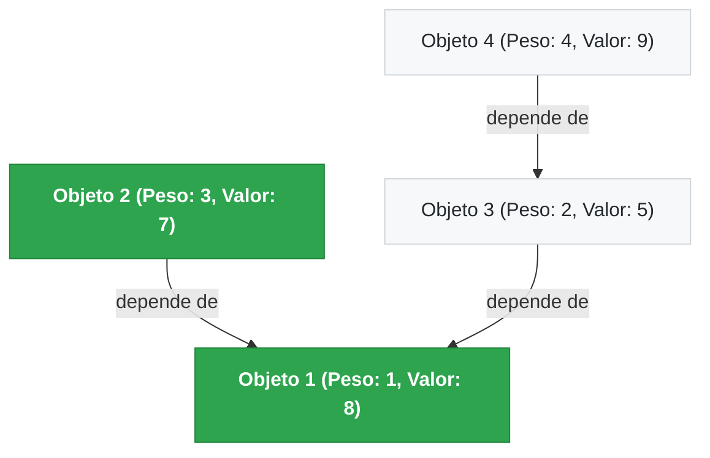

# 🎒 Problema da Mochila com Dependência (PCKP)

[](https://github.com/usuario/mochila-dependencia/actions)


Implementação em **C99** do **Problema da Mochila com Restrições de Precedência/Dependência** (*Precedence-Constrained Knapsack Problem - PCKP*), desenvolvida originalmente no contexto da disciplina de **Projeto e Análise de Algoritmos (PAA)** e refatorada com foco em boas práticas de engenharia de software, modularização e testes automatizados.

---

## 📌 Sumário
- [Visão Geral](#-visão-geral)
- [Formulação Matemática](#-formulação-matemática)
- [Algoritmo e Programação Dinâmica](#-algoritmo-e-programação-dinâmica)
- [Análise de Complexidade](#-análise-de-complexidade)
- [Exemplo Ilustrativo](#-exemplo-ilustrativo)
- [Estrutura do Repositório](#-estrutura-do-repositório)
- [Como Compilar e Executar](#-como-compilar-e-executar)
- [Suíte de Testes](#-suíte-de-testes)
- [Formato do Arquivo de Entrada](#-formato-do-arquivo-de-entrada)
- [Licença](#-licença)

---

## 🎯 Visão Geral

O problema clássico da mochila 0/1 busca selecionar um subconjunto de itens com peso e valor associados, respeitando uma capacidade máxima de modo a maximizar o benefício obtido. 

Na variante **com dependências**, um item só pode ser incluído na mochila se todos os seus **pré-requisitos** (itens dos quais ele depende) também forem selecionados.

### Aplicações Práticas:
- **Engenharia e Manufatura:** Montagem de equipamentos modulares em que peças avançadas dependem do encaixe prévio de componentes estruturais.
- **Gestão de Projetos de Software:** Priorização de épicos ou tarefas respeitando diagramas de dependências técnicas (ex: criar o banco antes da API).
- **Gamificação e Game Design:** Desbloqueio ótimo de árvores de habilidades (*skill trees*) com orçamento limitado de pontos.

---

## 📐 Formulação Matemática

Dado um conjunto de $n$ itens $\{1, 2, \dots, n\}$, onde cada item $i$ possui um peso $p_i > 0$ e um valor $v_i > 0$, uma capacidade inteira $C \ge 0$ e um grafo direcionado de dependências $G = (V, E)$, onde a aresta $(i, k) \in E$ denota que **o item $i$ depende do item $k$**:

$$\max \sum_{i=1}^{n} v_i x_i$$

Sujeito às restrições:

$$\sum_{i=1}^{n} p_i x_i \le C \quad \text{(Restrição de Capacidade)}$$

$$x_i \le x_k \quad \forall (i, k) \in E \quad \text{(Restrição de Dependência)}$$

$$x_i \in \{0, 1\} \quad \forall i \in \{1, \dots, n\}$$

---

## 🧠 Algoritmo e Programação Dinâmica

A solução adota uma abordagem de **Programação Dinâmica** baseada na construção de uma matriz bidimensional $X[(n+1) \times (C+1)]$, onde a entrada $X[i, b]$ representa o valor máximo realizável considerando apenas os primeiros $i$ itens com capacidade restante $b$.

### Relação de Recorrência

Para $i = 1, \dots, n$ e $b = 0, \dots, C$:

$$X[i, b] = \max \begin{cases} 
X[i - 1, b] & \text{(não incluir o item } i\text{)} \\
X[i - 1, b - p_i] + v_i & \text{se } p_i \le b \text{ e pré-requisitos de } i \text{ satisfeitos na subsolução}
\end{cases}$$

### Backtracking Recursivo
Após o preenchimento da tabela, os itens pertencentes à solução ótima são reconstruídos por retrocesso (*backtracking*) recursivo a partir da posição $X[n, C]$.

---

## 📊 Análise de Complexidade

| Métrica | Complexidade | Descrição |
| :--- | :---: | :--- |
| **Tempo** | $O(n \cdot C \cdot d)$ | $n$ itens, $C$ capacidades e $d$ verificações de dependências por estado |
| **Espaço** | $O(n \cdot C)$ | Memória alocada dinamicamente para a tabela de subproblemas |

---

## 💡 Exemplo Ilustrativo

Considere a instância com capacidade $C = 5$ e os 4 objetos a seguir:

| ID | Peso | Valor | Depende de |
| :---: | :---: | :---: | :--- |
| **1** | 1 | 8 | Nenhuma |
| **2** | 3 | 7 | Objeto 1 |
| **3** | 2 | 5 | Objeto 1 |
| **4** | 4 | 9 | Objeto 3 |



**Solução Ótima:**
- Itens escolhidos: **Objeto 1** e **Objeto 2**
- Peso total: $1 + 3 = 4 \le 5$
- Valor máximo: $8 + 7 = \mathbf{15}$

---

## 📁 Estrutura do Repositório

```text
.
├── Makefile                # Automação de compilação, testes e sanitização
├── README.md               # Documentação técnica do projeto
├── include/                # Arquivos de cabeçalho (.h)
│   ├── io.h                # Declarações de I/O, parsing e formatação
│   └── mochila.h           # Interfaces do algoritmo da mochila e estruturas
├── src/                    # Implementações em C (.c)
│   ├── io.c                # Leitura de arquivos, terminal interativo e visualização
│   ├── main.c              # Ponto de entrada e CLI (Command Line Interface)
│   └── mochila.c           # Lógica da DP, verificação de dependências e backtracking
├── tests/                  # Suíte de testes unitários e de integração
│   ├── test_mochila.c      # Test runner com 25+ assertions
│   └── inputs/             # Arquivos com instâncias de teste
│       ├── exemplo_aula.txt
│       ├── sem_dependencia.txt
│       ├── cadeia_dependencias.txt
│       └── capacidade_insuficiente.txt
└── legacy/                 # Código original acadêmico preservado
    └── mochila_original.c
```

---

## 🚀 Como Compilar e Executar

### Pré-requisitos
- Compilador C compatível com C99 (`gcc` ou `clang`)
- Utilitário `make`

### Compilação
Para compilar o binário principal otimizado:
```bash
make
```
O executável será gerado em `bin/mochila`.

### Modos de Execução

1. **Executar exemplo didático da aula:**
   ```bash
   ./bin/mochila --exemplo
   ```

2. **Exibir a matriz de Programação Dinâmica formatada:**
   ```bash
   ./bin/mochila -t tests/inputs/exemplo_aula.txt
   ```

3. **Carregar instância de um arquivo:**
   ```bash
   ./bin/mochila tests/inputs/sem_dependencia.txt
   ```

4. **Entrada via redirecionamento de fluxo (Pipe/Stdin):**
   ```bash
   ./bin/mochila < tests/inputs/cadeia_dependencias.txt
   ```

5. **Modo interativo guiado pelo terminal:**
   ```bash
   ./bin/mochila --interativo
   ```

---

## 🧪 Suíte de Testes

O projeto conta com testes unitários cobrindo casos clássicos, cadeias de precedência, bloqueios por itens pesados e limites de capacidade.

Para rodar todos os testes:
```bash
make test
```

Para rodar com **AddressSanitizer** e **UndefinedBehaviorSanitizer** (verificação rigorosa de integridade de memória e ausência de *leaks*):
```bash
make sanitize
```

---

## 📄 Formato do Arquivo de Entrada

Os arquivos de entrada aceitam comentários iniciando com `#` e linhas em branco:

```text
# Capacidade máxima da mochila
5

# Quantidade de itens
4

# Itens no formato: <peso> <valor>
1 8
3 7
2 5
4 9

# Matriz de adjacência n x n
# 1 na linha i, coluna j indica que o Objeto (i+1) depende do Objeto (j+1)
0 0 0 0
1 0 0 0
1 0 0 0
0 0 1 0
```

---

## 📜 Licença

Distribuído sob a licença [MIT](LICENSE). Consulte o arquivo `LICENSE` para mais detalhes.

